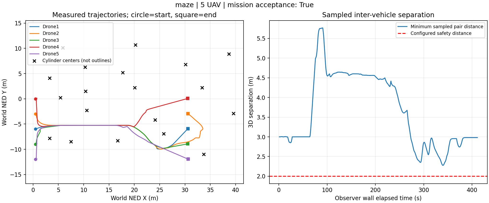

# A/B：障碍感知导航与编队恢复

本轮基于 `f5b48b97804a6119d4dd8960e30feb5e71246f9c`，保留 B 新增的
`FormationStatusGate`、三种名义队形、冲突解除事件锁存和 B→A 命令通道。
旧基线配置保持可用，新增行为通过独立 `navigation` 配置启用。

## 补齐的运行功能

1. **A→B 导航反馈**：各 A 控制进程把 LiDAR 实测 pose 下的回波转换为公共 NED，
   发布局部障碍表面点、原目标、路径是否可用、目标是否受阻、误差和路线版本。
   B 使用这些反馈调整目标，不直接读取 AirSim，也不直接控制飞机。
2. **有承诺的绕障路线**：A 在有限局部网格内搜索候选路径并保留已选路线，
   新回波挡住前方路段时立即停止使用该路段；搜索有范围、展开数和计算时间上限。
3. **有约束的退出动作**：当前位置落在首选膨胀边界内时，只有距离检查通过、
   对近处表面不继续接近的短距离退出候选才可执行；不是继续盲目前进。
4. **临时停车邻机绕行**：近期状态显示速度低的邻机参与临时路由检查，
   邻机恢复运动后不再作为临时障碍，不写入静态障碍记忆。机间 ORCA 和最终 CPA 仍保留。
5. **编队目标联合调整**：B 对受阻槽位生成邻近候选，再联合选择满足目标间距的组合，
   避免各机独立投影后落到同一个位置。调整受最大偏移范围约束。
6. **沿领航历史路径临时跟随**：遇到障碍约束或恢复路径受阻时，按真实领航历史的弧长
   生成跟随目标。历史长度不足的后续飞机先等待，分批汇入；不把当前航向后的直线偏移当作历史路径。
   开阔区域满足滞回条件、或领航到达终点且名义槽位可用后，恢复请求的原队形。
   临时跟随距离另外考虑停车和预测窗口：本轮 0.35 m/s、3 s CPA、2 m 安全距离下，
   临时间距为 4.6 m；名义横队间距仍为 3 m。不能只把名义间距照搬到停车纵队。
7. **领航等待与恢复**：根据跟随机反馈的目标误差和路径状态等待，误差达到较小阈值后再恢复，
   缺反馈或旧反馈不会被当作“已经跟上”。
8. **运行清理**：B 增加停止文件，启动器在各机清理结束后让 B 退出，减少 Windows 信号退出的不确定性。

## 代码边界

| 内容 | 文件 |
| --- | --- |
| 反馈约束、局部网格搜索、路线承诺与退出候选 | `coordination/navigation.py` |
| LiDAR 公共坐标、临时邻机、领航等待、实际速度候选 | `control/swarm_flight_bridge.py` |
| 身份/任务/序号检查、原始状态时效与广播 | `coordination/state_service.py`、`coordination/wire.py` |
| 接收缓存、重复观测不续期、反馈随状态发送 | `coordination/controller_link.py` |
| 槽位调整、历史路径、分批汇入与原队形恢复 | `formation/navigation.py` |
| 保留的 B 纯算法及可选目标覆盖 | `formation/controller.py` |
| B 状态门控和网络运行 | `formation/runtime.py`、`scripts/formation_service.py` |
| 独立两/五机配置 | `configs/acceptance/swarm_2_navigation.yaml`、`swarm_5_navigation.yaml` |

新模式的水平巡航候选由网格路线跟踪产生，替代盲脱困和原局部规划器的水平候选。
原 CBMBA/APF/轨迹模块仍保留供旧模式和诊断使用；日志中的旧局部规划结果不是新模式最终派发结果。
2026-11-19 后，新网格模式默认不启动旧 CBMBA/轨迹/建图诊断 worker 和 UE debug draw，
巡航自身状态复用 A 权威快照；旧模式保持原行为，显式启用 `run_legacy_diagnostics` 可恢复诊断负载。
原始安全点云独立于过滤结果供最终网关检查，0.6 s 限制不放宽。详见
[时效与负载排查](A_感知时效与负载排查_2026-11-19.md)，该轮没有重跑真实飞行。
新候选仍经过原 ORCA、限速、控制权、原命令 permit、完整新鲜快照和原始 3D LiDAR 最终网关。
控制周期过载、碰撞、失效感知和紧急垂直逻辑仍按原有安全路径处理。

## 协议补充

在 `coordination.status` 中增加可选 `navigation`，不增加 B 的飞行权限：

```json
{
  "observation_id": 1795010000000000000,
  "obstacle_resolution_m": 0.25,
  "obstacle_points_xy_m": [[8.0, -4.0], [8.25, -4.0]],
  "goal_ned_m": [15.5, -3.0, -2.0],
  "path_available": true,
  "goal_blocked": false,
  "tracking_error_m": 2.5,
  "route_version": 3
}
```

- `observation_id` 是原始 LiDAR 仿真纳秒时间戳，不是发包时间。点是公共 NED 的 XY，单位米。
- 障碍点最多 512 个；坐标、误差、类型和分辨率均检查。缺少分辨率的早期反馈按 0.6 m 处理。
- A 仅接收该飞机已注册控制进程的反馈，检查连接身份、序号、任务和观测相对权威状态的仿真时差。
  C 无权注入。服务端重发状态也不能刷新控制进程的原始状态到达时间。
- B 和领航缓存同时检查本地接收年龄与仿真观测时间；重复观测 ID 不刷新年龄，断连清空缓存。
- 反馈新鲜度与静态障碍记忆是两件事：反馈过期停止相应协同；静态障碍短期保留以应对遮挡，
  不把重复旧包当作新观测。
- B 临时跟随命令的诊断 `formation_id` 为 `line:trail` 等，名义三种队形不变。
  A 不把到达临时汇入点报告成原队形完成；恢复后使用普通名义队形 ID。

旧 A 的严格状态构建器可能拒绝新增字段，因此本功能应使用同一分支的 A/B 联调。
`command.ack` 仍只代表接收，原双时钟期限、permit 和最终安全检查不被延长或跳过。

## 参数与复现

新增配置默认关闭；示例显式启用 `enabled`、`adaptive_slots`。
`trail_fallback` 可关闭用于对照；`maintain_heading` 默认在新模式输出零航向角速度，
保持起飞对准后的航向，避免把机身转向瞬间放大成远端横队槽位的大幅旋转。

验收新配置使用 0.25 m 网格、1.1 m 首选规划余量；最终 LiDAR 硬净空仍为轨迹配置的 0.9 m，
机间安全距离仍为 2 m。退出动作允许离开首选膨胀区域，但最低约束取硬净空并补偿网格量化，
仍须通过原始点云与实测运动/有限指令时长检查。不能将首选规划余量等同于独立安全认证距离。
编队目标保留额外规划间距，合流仍以 A 的实时邻机检查为准。

在仓库根目录、对应 settings 的独立 Blocks 实例加载完成后执行：

```powershell
$py='C:\Users\Liuziyi\AppData\Local\Python\pythoncore-3.14-64\python.exe'
$env:AIRSIM_PYTHONCLIENT_PATH='D:\30817\Adrone\airsim\AirSim-main\PythonClient'
& $py scripts/run_swarm_acceptance.py --blocks-project D:\30817\Adrone\blocks\Blocks.uproject --settings-json configs/acceptance/settings_2.json --swarm-config configs/acceptance/swarm_2_navigation.yaml --formation-config configs/acceptance/formation_2.yaml --map-label maze --output runs/acceptance/navigation_2_repeat --duration 240 --confirm-simulation-clearance
```

五机先使用 `settings_5.json` 重启自己的仿真实例，然后将以上三份配置改为五机版本，观测上限 540 s。
五机新配置使用独立 `flight_5_navigation.yaml`，巡航墙钟上限 480 s；旧基线仍为 300 s。
这是明确增加的保守路径/分批汇入预算，不能据此宣称同一时间预算下性能提升。
首轮五机请求 `t.MaxFPS 30`，后续复测请求 `t.MaxFPS 0`；报告同时记录实际仿真时间与墙钟时间之比，
不会只凭墙钟耗时比较算法速度。
运行目录必须全新。没有完成任务、只达到时间上限、单纯无碰撞或收到 ACK，均不得算飞行通过。
新增 `navigation.jsonl` 记录不重复的反馈摘要、障碍点数量/哈希和路线版本；B 日志记录名义/临时跟随切换。
全程名义队形误差与反馈中的当前目标误差分别统计，不能把临时跟随时偏离横队的误差隐藏掉。

## 本轮实测证据

最终双机 `navigation_2_final` 通过：651/651 个完整采样，最小采样间距 2.27811 m，
分段线性插值最小间距 2.27800 m，零观测障碍碰撞；领航 `mission_complete`，
跟随机 `coordinated_stop`，两机均确认落地、解锁并释放控制权。
领航巡航墙钟 99.00 s，B 同样记录 `nominal → trail → nominal`；名义横队误差
RMSE 4.591 m、最大 7.153 m，集结容差内采样 27 帧。
A 状态采集平均 1.209 ms、P95 2.337 ms；观测仿真/墙钟时间为
102.116 / 133.161 s，比值 0.767。该轮所有 Python 源码哈希与提交前最终工作树一致。

最终五机 `navigation_5_run02` 通过任务验收：1952/1952 个完整采样，领航
`mission_complete`，四架跟随机原队形恢复后 `coordinated_stop`，五架均确认落地、
解锁、释放控制权，启动器返回 0。B 实际记录 `nominal → trail → nominal`。

| 指标 | 五机实测 |
| --- | ---: |
| 最小采样间距 | 2.27655 m |
| 分段线性插值最小间距 | 2.27654 m |
| 观测障碍碰撞 | 0 |
| 名义横队误差 RMSE / 最大 | 10.031 / 20.831 m |
| 名义集结容差内采样 | 37 帧 |
| 反馈当前目标误差 RMSE / 最大 | 3.726 / 17.317 m |
| A 状态采集平均 / P95 | 2.416 / 3.045 ms |
| 领航巡航墙钟时间（包含等待恢复） | 366.07 s |
| 观测仿真时间 / 墙钟时间 | 215.465 / 410.054 s（比值 0.525） |

沿历史路径临时纵队通过障碍，终点再展开横队，因此全程名义横队误差较大。
该结果验证本任务的避障和恢复闭环，不代表全程紧密横队、算法普遍收敛或所有地图验收。
即使请求取消帧率上限，本机实测仿真仍慢于墙钟，报告保留实际时间比。

开发阶段 `navigation_2_run05` 也完成闭环：710 个完整采样，最小采样间距 2.27945 m，
零观测障碍碰撞，两机确认落地并释放控制；领航巡航 107.69 s。该轮早于临时纵队停车余量等修订。
前两次双机人工协调停止，后两次双机以及首轮新五机达到时间上限，均未计为通过；
原始日志均保留，汇总随最终证据一起提供。

导出目录为 `artifacts/acceptance/2026-11-18-navigation/`，包含摘要、完整采样轨迹 CSV、
轨迹/间距图、导航反馈摘要及原始文件 SHA256。完整 A/B/各机日志保留在本地 `runs/acceptance/`。
每轮环境记录实际 Python 源码、配置、地图资产的 SHA256，包含未提交代码，不能仅凭 Git HEAD 还原试验。
五机运行结束前只调整了导出器以附带导航摘要；该工具不参与飞行控制，实测核心代码不变。
哈希基于运行时文件字节，Git 检出的换行转换也会改变字节哈希，应结合源码差异复查，不能倒填指纹。



左图黑叉只表示柱体中心，不表示柱体边界；右图是离散状态采样的最小机间距。
完整采样和分段线性插值不能替代连续时间安全证明。

飞行结束后，真实 AirSim/A 状态服务上的协议检查 18/18 通过，覆盖 ACK、permit、
重复 ID、旧序号、未知车辆、任务错误、双时钟期限、B 断连撤销、重连重放和 C 权限。
协议试验没有执行飞行控制，不代表已经实测空中断连或空中故障恢复。
本次独立启动的仿真实例已在确认全部 API 控制释放、仿真未暂停后退出。

最终工作树全量回归：`python -m pytest -q`，**1418 passed，248.91 s**。
JUnit 报告随证据导出为 `tests.xml`。新增回归覆盖障碍后的路线保持与重检、受约束退出、
临时停车邻机、联合槽位分配、历史路径转角与分批汇入、原队形恢复、重复/过期反馈、
原状态心跳时效、紧急状态不被旧反馈阻断，以及临时目标不得冒充名义集结完成。

## 文献关系与验证限制

本轮是工程适配，参考多路径/子目标与弹性编队思想，不是以下论文的完整复现：

- RAPTOR，IEEE T-RO 2021，DOI [10.1109/TRO.2021.3071527](https://doi.org/10.1109/TRO.2021.3071527)，
  [作者 Fast-Planner](https://github.com/HKUST-Aerial-Robotics/Fast-Planner)。本轮没有复现其完整 B 样条优化和感知规划。
- Robust and Efficient Trajectory Planning for Formation Flight in Dense Environments，IEEE T-RO 2023，
  DOI [10.1109/TRO.2023.3301295](https://doi.org/10.1109/TRO.2023.3301295)，
  [论文公开稿](https://arxiv.org/abs/2210.04048)。作者公开的
  [Swarm-Formation](https://github.com/ZJU-FAST-Lab/Swarm-Formation) 主要对应 ICRA 2022 早期版本。
  本轮没有声称实现其完整图相似性优化、MINCO 或全局重映射方法。

当前是近似定高、有限局部观测的 2D 规划；未观测空间只能用于候选搜索，不能由占据点稀疏推断全局安全。
执行端的有限时长检查也不是带真实加速度、制动和感知不确定性的连续时间安全证明。
多候选网格搜索不保证候选都属于不同同伦类，也不提供完整地图下的目标收敛证明。
需要以原五机失败位置继续实测，并保留超时、保护停机、人工停止和碰撞记录。
