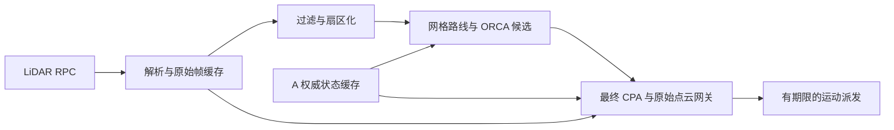

# A：maze_2_mytest_03 感知时效与负载排查

本轮基于 `cc2f976`（已包含 B 的运行时配置接线），分析用户提供的
`D:\30817\Adrone\B同学测试失败日志11_19`。原始文件保持只读，记录 SHA256；
未把新的本机结果覆盖或冒充 B 的失败结果。
用户已确认失败来自 **B 的另一台电脑**。本机进程检查不能证明 B 电脑的旧实例已安全结束。
B 仍需在原电脑核实原 Drone1 状态；`MANUAL_INTERVENTION_REQUIRED` 不等于已降落。

## 确定的故障链

1. `Drone1.log:1292`，10:32:48，A 报 `lidar_unavailable_at_gateway`。
2. Drone1 以 `velocity_send_error` 退出，巡航 25.828 s、92 帧；未确认落地、解锁或 API 释放。
3. Drone2 随后 `coordinated_stop`，确认落地并释放控制。
4. B 日志记录 50 个 accepted ACK、0 个 rejected ACK。首个退出原因不是 B 命令拒绝，
   不能把这次失败归因于 B 的槽位算法。ACK 只表示 A 接收命令，不豁免最终网关。

B 报告中的 A 核心文件与修复前主分支一致；6 份运行配置的字节哈希也与本机基线一致。
区别主要是测试电脑与实际运行负载，不能拿本机历史通过记录否定 B 的失败。

| B 日志指标 | 记录 |
| --- | --- |
| 控制频率 | 3.56 Hz；目标 20 Hz |
| 控制周期中位 / P95 / 最大 | 250 / 453 / 625 ms |
| 超时告警 | 84 次，严重超时 1 次 |
| 感知快照接收年龄平均 / P95 | 313.88 / 516 ms |
| 故障前 LiDAR RPC | 约 300 ms，仍返回约 8000 个点 |
| 故障前一条感知处理记录 | 107.12 ms |
| 第 90 帧自身状态 RPC | 131.98 ms，占该帧工作时间 181.64 ms 的大部分 |
| 后台建图平均 / P95 | 118.94 / 150.60 ms |

非空不等于新鲜。旧感知层停车阈值与网关的 0.6 s 阈值不同，所以 `lidar_stale=0`
不代表最终派发满足 0.6 s。旧网关只缓存主循环前面消费的那一帧；后台随后有新数据，
也不会自动替换它。主循环继续处理、等待状态 RPC 后，这份缓存可能在派发点过期。
旧日志未记录拒绝当刻的精确帧 ID/年龄，不能倒填一个具体过期毫秒数。

## A 侧修复

### 原始安全扫描与规划感知分开发布

`PerceptionWorker` 在过滤、降采样、扇区化之前发布已经由 `LidarReader` 解析的原始帧。
网关在派发点读取该缓存，无额外 RPC，不等待后台过滤完成；仍使用完整原始点云、
实测传感器 pose 和公共 NED 坐标进行最终三维扫掠净空检查。



不使用过滤后的点云替代安全点云，不丢弃近处回波，不放大 0.6 s 限制。
同一扫描 ID 的重复读取不刷新缓存年龄；处理完成的旧帧不能覆盖更新的原始安全帧。
缺失/错误扫描 ID、无效帧、未来时间和超时均拒绝，失效不会变成无限悬停许可。

### 明确传输时间，不给处理过程续期

`LidarFrame.request_started_monotonic_seconds` 保存 RPC 发出时刻，
`received_monotonic_seconds` 仍是 RPC 返回时刻。网关将 RPC 耗时计入预算，
不以过滤或发布完成时间给旧数据续期；还检查扫描与 A 最新权威状态的仿真时间差。
运动时长同时受剩余状态期限、扫描期限、permit/TTL 和配置指令时长限制。

RPC 开始时刻是传输预算基准，不是物理扫描生成时刻的严格证明。
不能跨减仿真 ns 与本机单调秒；原始仿真时间只和同一模拟器权威时间比较。

拒绝日志新增 `gateway_freshness`：车辆、原因、扫描 ID、RPC 开始年龄、接收年龄、
快照年龄、阈值和来源。这样下一次可以区分“没有扫描”“扫描传输就很慢”和“主循环缓存老化”。
原来的 `lidar_unavailable_at_gateway` 保留；仿真时间偏差过大另报 `lidar_sim_time_skew_at_gateway`。

### 控制循环减负

启用新网格导航时，默认不运行已不负责实际水平候选的旧 CBMBA、轨迹和建图 worker，
也不启动旧 UE debug-draw RPC 客户端。网格障碍记忆/路线、原始点云、扇区感知、
碰撞读取、ORCA、CPA、命令生命周期、控制权和最终网关继续保留。
巡航自身状态复用 A 的完整新鲜权威快照，再转换回本机原点，不再每周期重复自身状态 RPC。
起飞前的真实状态与坐标校验仍保留。

`navigation.run_legacy_diagnostics: true` 可以显式恢复旧诊断负载做对照。
没有启用 `navigation.enabled` 的旧独立导航模式行为不变。
这次是 A 网格模式的运行减负，**没有修改 B 的槽位算法或三种队形定义**。

体素最近点筛选从每个 voxel 的 Python 循环改为一次向量排序；保持最近点、等距时原始输入优先级、
输出顺序和移除计数。地面数据上逐帧与原 `cc2f976` 实现逐元素对比，一致后才统计性能。

## 单 / 双 UE 地面对照结果

只在本机创建独立 `/Game/maze` 实例；两机一直 Disarmed/落地、API 未开启，未运行飞行启动器。
主实例 41451，第二实例临时 settings 使用 41452，两个窗口均为 960×540，未修改用户默认 settings。
由进程/端口核对确有两个不同 UE 进程。依次测单实例、双实例、关闭第二实例后再测主实例，
每机每组 40 个有效样本，另有 5 个预热样本。

| 本机地面条件 | Drone1 LiDAR 中位 / P95 | Drone2 LiDAR 中位 / P95 |
| --- | ---: | ---: |
| 单 UE，前测 | 3.539 / 4.768 ms | 3.616 / 4.638 ms |
| 双 UE | 2.945 / 3.953 ms | 2.944 / 4.235 ms |
| 单 UE，后测 | 3.849 / 6.057 ms | 3.899 / 5.930 ms |

同批约 1 万点地面数据的过滤中位数由约 11.8～13.6 ms 降到 2.0～2.7 ms；
所有记录样本的新旧输出一致。这不是“飞行控制已恢复 20 Hz”的实测结论。

本机没有复现 300 ms RPC，也没有观察到这一对照下双 UE 明显加重延迟。
**B 使用另一台电脑，因此不能据此排除 B 机器上的 CPU/GPU/内存竞争。**
地面与飞行渲染/动力学/点云分布、硬件、电源、温度及后台负载都不同；
现有证据不足以确认历史根因是 Blocks 或两个 UE。
初次地面采样早于 RPC 服务就绪，没有产出样本；增加就绪等待后才取得表中结果。

## 给 B 的下一步排查命令（先地面，不重跑飞行）

在 B 自己能够运行现有项目的 Python 环境中，更新完整修复分支，保留 Git 历史供基线对照。
不要只复制一个控制文件，采集帧、网关和运行模式的修改需要一起使用。
先由 B 在原电脑确认旧 Drone1 状态、停止原控制进程并安全结束故障仿真实例。

```powershell
# 记录两个 UE 分别是什么进程、什么项目，以及谁持有 AirSim 端口。
Get-CimInstance Win32_Process | Where-Object { $_.Name -match 'UE4|Unreal|Blocks' } | Select-Object ProcessId,Name,CommandLine
Get-NetTCPConnection -State Listen | Where-Object { $_.LocalPort -in @(41451,41452,8765) } | Select-Object LocalPort,OwningProcess

# 独立启动一个地面双机场景，不启动 launch_swarm，不解锁。
python scripts/profile_swarm_ground.py --settings-json configs/acceptance/settings_2.json --swarm-config configs/acceptance/swarm_2_navigation.yaml --case single_ue_before --output runs/ground_latency/single_before.json

# 如需双 UE 对照，第二个用临时 settings 的独立 RPC 端口 41452，确认也在地面。
# 主实例、地图、LiDAR、窗口分辨率和采样参数保持不变。
python scripts/profile_swarm_ground.py --settings-json configs/acceptance/settings_2.json --swarm-config configs/acceptance/swarm_2_navigation.yaml --case dual_ue --output runs/ground_latency/dual.json

# 安全关闭第二个实例，再对同一主实例重复测量。
python scripts/profile_swarm_ground.py --settings-json configs/acceptance/settings_2.json --swarm-config configs/acceptance/swarm_2_navigation.yaml --case single_ue_after --output runs/ground_latency/single_after.json
```

`--case` 只是记录标签，不会替你启动、关闭或判断第二个实例是否存在。
请同时记录是否都在 Play、背景限帧/低 CPU 选项、分辨率、录屏/视频服务、CPU/GPU/内存负载、
硬件与电源模式。不要把端口冲突误当成纯性能竞争。
脚本只调用读状态、读 LiDAR、读碰撞等接口；发现飞机未落地、API 被占用、场景暂停或配置不匹配就停止。

```powershell
python scripts/analyze_swarm_latency.py --logs "原始失败日志目录" --output runs/ground_latency/provided_failure_analysis.json
```

如目标电脑持续返回约 300 ms 或更慢 RPC，原始帧未必有足够 0.6 s 预算，
即使修复后网关仍可能正确拒绝。先定位采集与系统负载，不以扩大时效阈值代替解决问题。

## 验证范围

新增回归涵盖慢 RPC、晚完成的规划帧、重复扫描、缺失时间戳、仿真时间偏差、
未来本机时间、无效帧、剩余派发时长、慢过滤前原始帧发布、体素输出等价和轻量循环无旧任务。
原测距、传感器安装偏移及三维净空断言继续保留，旧测试夹具补齐实际帧模型已有的扫描时间戳。
首轮全量报告的夹具缺字段失败保存在本地，不作为通过记录。
最终全量回归：**1476 项通过，0 失败、0 错误、0 跳过，252.001 s**。

汇总与原始报告哈希见 `artifacts/perception_latency/2026-11-19/`。
**按用户要求，本轮未重跑真实飞行，尚未完成 B 电脑上的修复后飞行验收。**
本机地面诊断实例已在确认落地、API 未开启后退出；这不能替代 B 原机的现场确认。
